# Victor Germano

### Software Engineer · Enterprise AI Systems · Autonomous Agents

---

## About

Full Stack engineer specializing in **enterprise backend systems**, **autonomous AI pipelines**, and **production-grade APIs**. Currently at Grupo Roveri as ControlDesk Jr. — promoted internally — where I designed and delivered the company's internal MDM/EMM infrastructure, approved end-to-end by management, development and cybersecurity teams.

- 📍 São Paulo, Brazil
- 🎓 B.Sc. Software Engineering (in progress) — Universidade Cruzeiro do Sul
- 🔧 Core stack: TypeScript · Node.js · Fastify · PostgreSQL · Redis · Python · React

---

## What I Build

| Domain | Focus |
|---|---|
| **Enterprise Backend Systems** | MDM/EMM, CRM, fiscal automation — job queues, RBAC, audit trails, idempotent APIs |
| **Autonomous AI Agents** | Multi-agent pipelines with Claude AI: prospecting, diagnosis, generation, delivery |
| **Security Tooling** | SAST platform — 38 detection rules, real AST parsing across 8 languages |
| **Full Stack Products** | SaaS platforms, e-commerce, B2B portals — React/Next.js on robust backends |

---

## Stack

**Languages**

**Backend & Runtime**

**Frontend**

**Data & Infrastructure**

**AI**

 

---

## Featured Projects

| Project | Description | Stack | Status |
|--------|-------------|-------|--------|
| [Mobile Device Management](https://github.com/victor-germano/Sistema-de-monitoramento-de-celulares-para-infraestrutura) | Corporate EMM/MDM built for Grupo Roveri — Android Management API, BullMQ job queues, RBAC, full audit trail, enrollment flow. Approved by management, dev and cybersecurity | Node.js · TypeScript · Fastify 5 · PostgreSQL 16 · Redis · Next.js | ✅ Production |
| [AI Sales Automation](https://github.com/victor-germano/agente-de-automacao) | 7-agent autonomous pipeline: prospect → AI diagnosis → generate landing page → deploy → deliver via WhatsApp/Gmail. No human steps before final approval | TypeScript · Node.js · Claude AI · Puppeteer | ✅ Shipped |
| [SAST Security Platform](https://github.com/victor-germano/verificador-de-vulnerabilidades) | Static analysis engine — 38 detection rules, real AST parsing (8 languages), Docker Compose stack, standalone CLI, CI integration, exportable reports | Python · FastAPI · React · PostgreSQL · Docker | ✅ Shipped |
| [Fiscal Automation Agent](https://github.com/victor-germano/agente-emissao-nfse) | Autonomous NFS-e emission agent — atomic idempotency, exponential retry/backoff, Stripe webhook reconciliation, LGPD audit trail, concurrent test suite | Node.js · TypeScript · Fastify · Supabase | ✅ Shipped |
| [Solar Energy CRM](https://github.com/victor-germano/CRM-ENERGIA-SOLAR) | B2B prospecting CRM — Kanban pipeline, CNPJ enrichment via Receita Federal API, 1-click PDF proposals, dialer queue integration | React · TypeScript · Supabase · PostgreSQL | ✅ Production |
| [Alma Estudos Visuais](https://github.com/victor-germano/alma-estudos-visuais) | Artist studio website — custom visual identity, CSS3 animations, responsive gallery. Pure HTML/CSS/JS, no framework overhead | HTML · CSS3 · JavaScript | ✅ Shipped |

---

## Activity

<picture>
    <source media="(prefers-color-scheme: dark)"
        srcset="https://raw.githubusercontent.com/victor-germano/victor-germano/output/pacman-contribution-graph-dark.svg">
    <source media="(prefers-color-scheme: light)"
        srcset="https://raw.githubusercontent.com/victor-germano/victor-germano/output/pacman-contribution-graph.svg">
    
</picture>

---

## GitHub Stats

---

[LinkedIn](https://www.linkedin.com/in/victor-germano-65787b2b1) · [Portfolio](https://germanodev-portfolio.netlify.app/)

